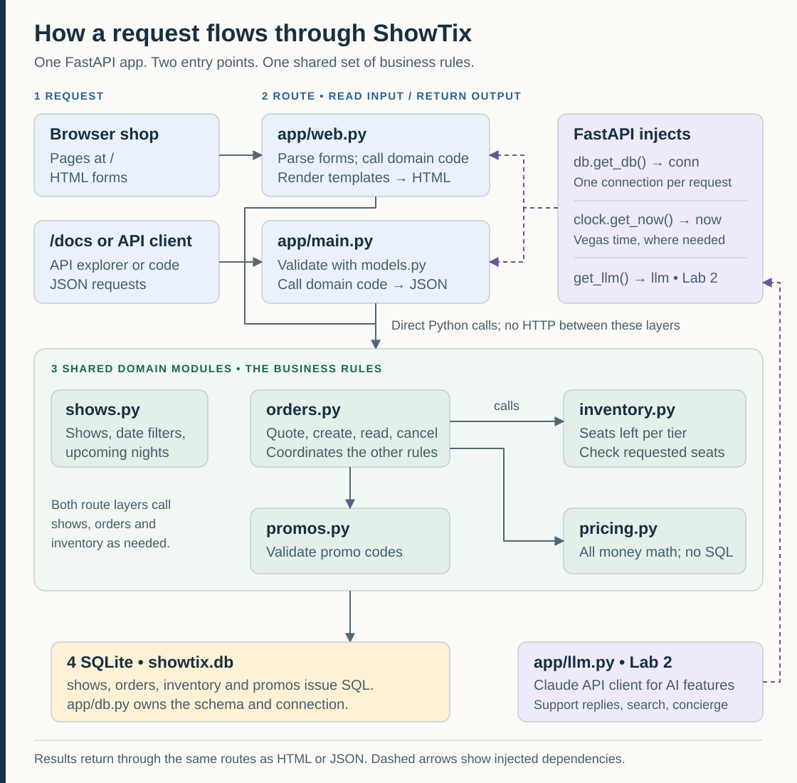
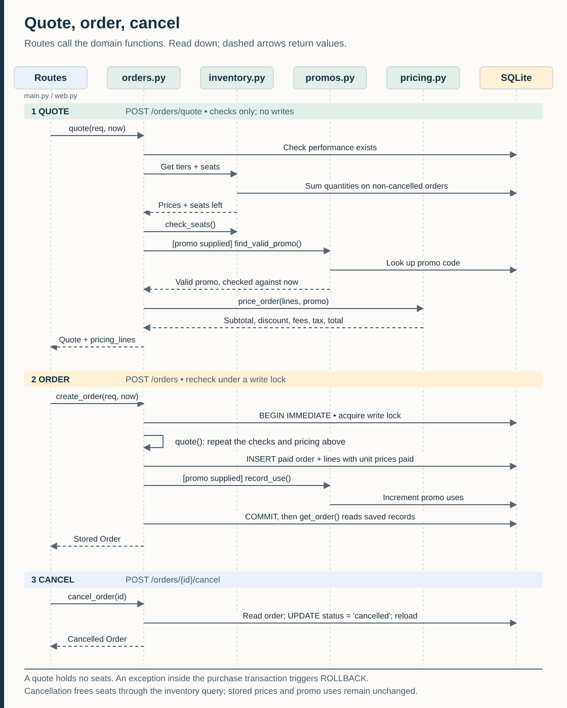
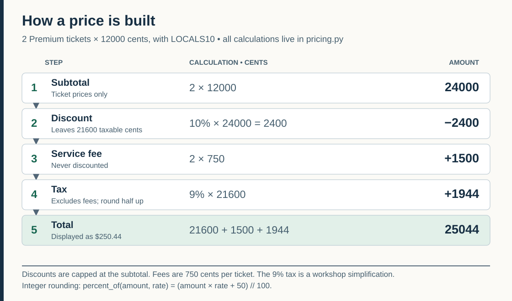
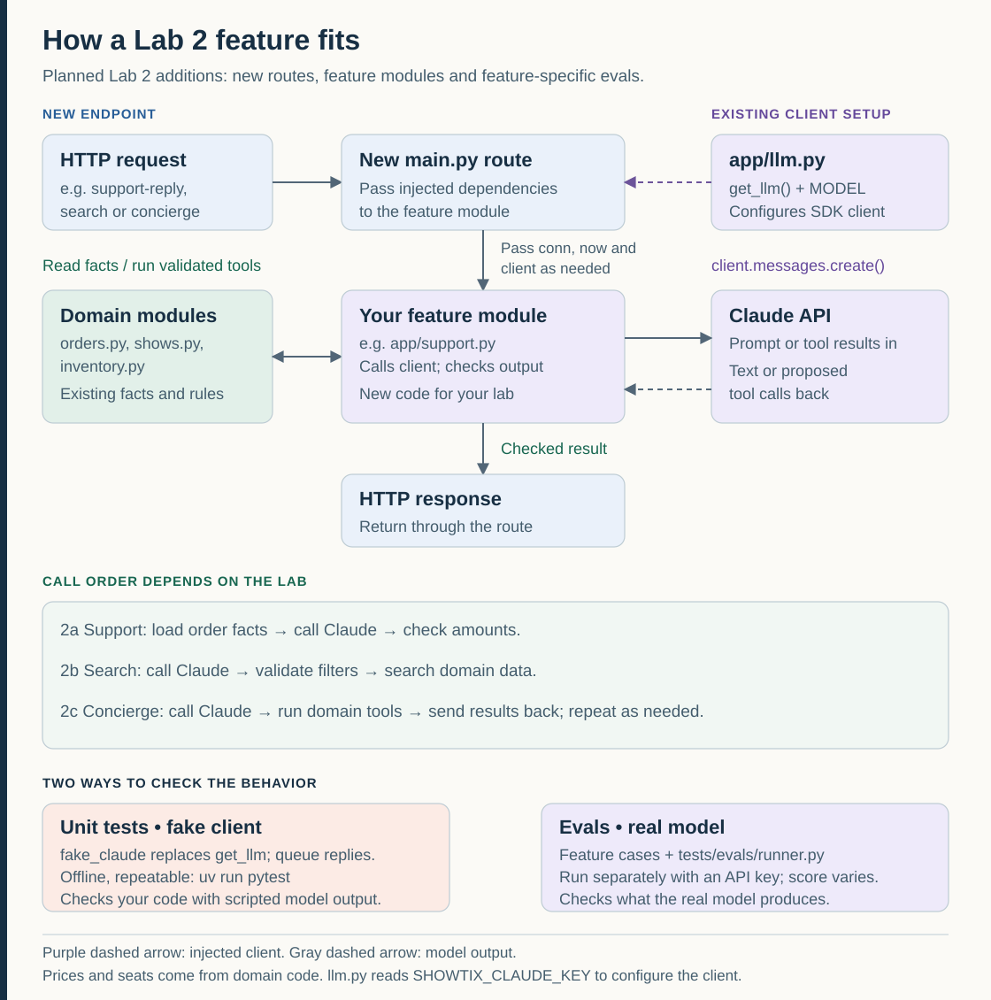
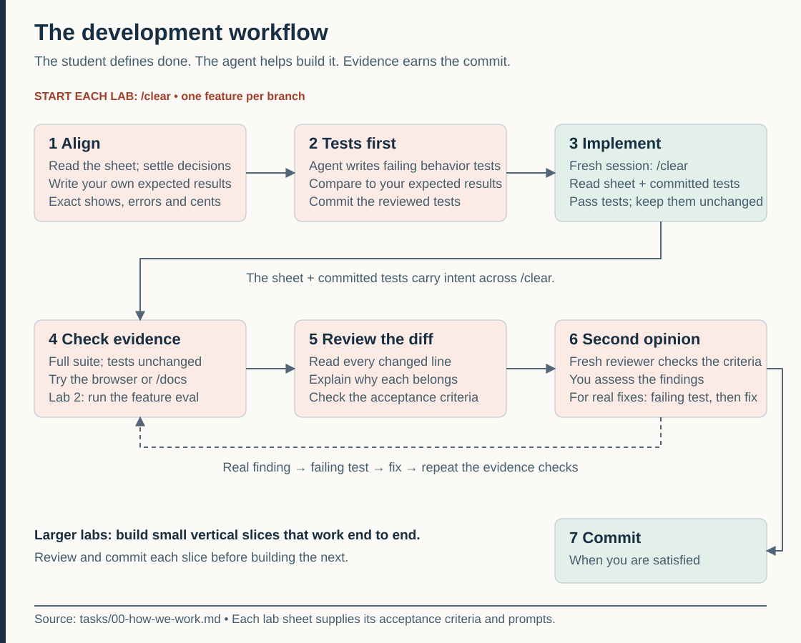
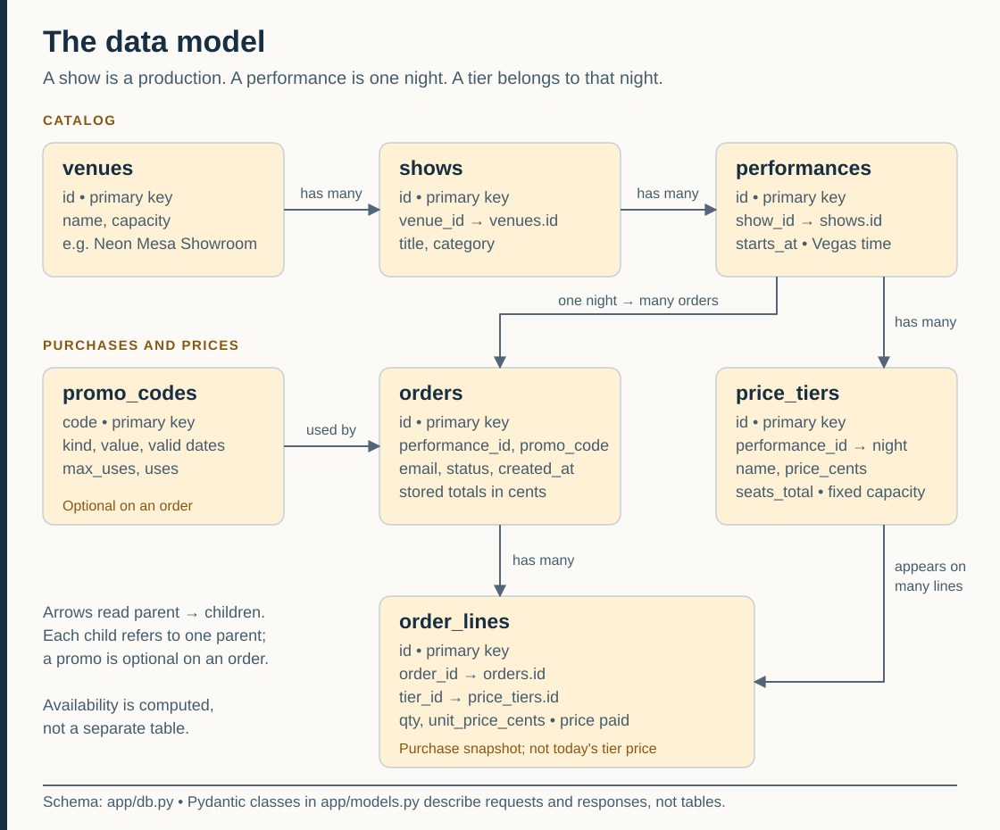
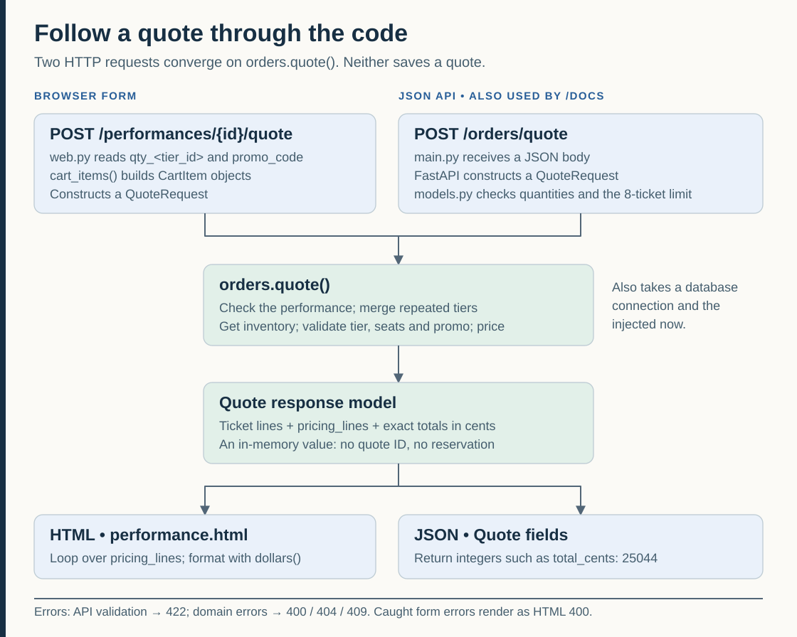
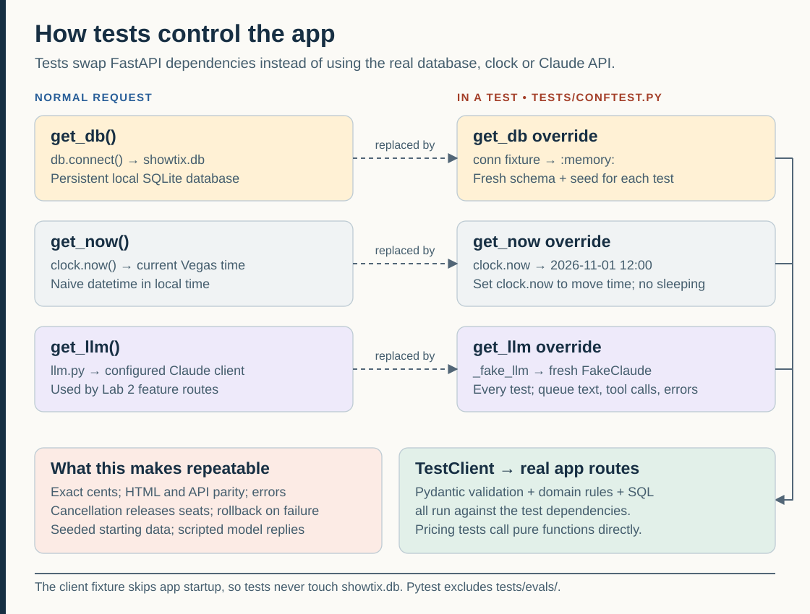

# How ShowTix fits together

Eight pictures of the app and the way we work on it. Read this before your first lab, or whenever a sheet sends you into code you haven't seen. All eight are editable SVG files in [`img/`](img/), so they stay sharp when enlarged. The original Mermaid sketches for pictures 1 to 5 remain in [`diagrams/`](diagrams/). Not sure where to start? See [Where to start a feature](#where-to-start-a-feature).

## 1. How a request flows through the app

- **Routes hold no business rules.** `app/main.py` (the JSON API) and `app/web.py` (the pages) read the request, call a domain module, and return what it gives back. A checkbox on every sheet checks this.
- **The rules live in the domain modules.** `orders.py` runs quote, order and cancel, and calls the other three.
- **All money math is in `pricing.py`.** Nothing else adds, discounts or taxes money.
- **Time and the Claude client are injected.** Routes get the current time from `clock.py` and the Claude client from `llm.py` (Lab 2), so tests can swap in a fixed time and a fake Claude.

**Check your understanding:** If a fee changes, do both route files need a new formula? No. Change the rule in `pricing.py`; both paths use it.

## 2. Quote, order, cancel

- **A quote writes nothing.** It checks seats and the promo code, then prices the cart.
- **An order prices itself by calling `quote()`,** then writes the order, its lines (with the price paid, captured now) and one promo use, all inside one lock.
- **Seats are never stored as a count.** Seats sold is the sum of order lines on orders that aren't cancelled, so cancelling an order frees its seats with no extra code.
- **A quote is not a price guarantee or a seat hold.** Current facts are checked again at purchase, and the form sends quantities and a promo, never an amount the server trusts.
- **Quote and purchase have two entry points.** The API uses `POST /orders/quote` and `POST /orders`; browser forms use `POST /performances/{id}/quote` and `POST /performances/{id}/orders`. Cancellation is API only: `POST /orders/{id}/cancel`.
- Labs 1b, 1d, 1e and 1f all change something in this picture.

**Check your understanding:** Why is there no `seats_left = seats_left + qty` in cancellation? Seats left is worked out on every read; a second counter would duplicate that information.

## 3. How a price is built

- **The order of these five steps is the core rule of the app.** It's also in `CLAUDE.md`.
- **The promo discounts the subtotal only.** The $7.50 service fee is never discounted.
- **Tax is 9% of the discounted subtotal, not the fees,** rounded half up to the cent once.
- **Every amount is integer cents.** Use this example to check your own expected results: 2 Premium with LOCALS10 totals 25044.

**Check your understanding:** In this example, is tax charged on 24000, 21600 or 23100 cents? On 21600, the discounted subtotal, which gives 1944.

## 4. How a Lab 2 feature fits

- **These are features you build in Lab 2.** The client dependency, fake and shared eval runner exist today; the feature routes, modules and feature-specific evals are lab additions.
- **The call order depends on the feature.** Support replies load order facts before calling Claude. Search asks Claude for filters, validates them, then queries the domain modules. Concierge alternates model calls with domain tools and sends their real results back to Claude.
- **`llm.py` configures the client and supplies `MODEL`.** FastAPI injects the client through `get_llm()`; the route passes it to feature code, which calls its `messages.create()` method.
- **Your code checks what comes back** before it reaches the customer. Prices and seats always come from the domain modules, never from the model.
- **Two kinds of checks.** Unit tests use `fake_claude`: scripted replies, offline, the same every run. The eval calls the real model and prints a score that can change from run to run.

**Check your understanding:** If Claude proposes a quote for 20 tickets, who rejects it? Your validation and the domain code; the model doesn't get around the ticket limit.

## 5. The workflow

The workflow every sheet follows. [`tasks/00-how-we-work.md`](../tasks/00-how-we-work.md) explains each step and why; each sheet has the prompts.

**Check your understanding:** What survives `/clear` and tells the next session what "done" means? The written criteria and your reviewed, committed tests.

## 6. The data model

- **A show is a production; a performance is one night.** Prices and seats belong to the night, through `price_tiers`.
- **`order_lines.unit_price_cents` is the price paid.** It's captured at purchase, so old orders never change when tier prices do.
- **`seats_total` is the tier's capacity.** `venues.capacity` only helps generate the seed tiers; it isn't a live seat counter.
- **A quote is not a table.** It's a response object. The Pydantic classes in `app/models.py` describe requests and responses, not rows. The full schema is in `app/db.py`.

**Check your understanding:** Why does a price tier belong to a performance rather than a show? Each night has its own prices and seats.

## 7. Follow a quote through the code

- **Two ways in, one function.** The page and the API build the same `QuoteRequest` and call the same `orders.quote()`. The page doesn't call the JSON API; `web.py` calls Python directly.
- **Shape checks and fact checks live in different places.** `models.py` checks the request's shape, positive quantities and the 8-ticket limit. Domain functions check facts: does the tier belong to this night, are enough seats left, is the promo valid today?
- **Errors depend on the door.** In the API, a bad request shape is JSON 422 and domain errors are JSON 400, 404 or 409. Cart errors on an existing performance show the form again as HTML 400. A missing performance returns JSON 404, even from a form submission; a nonnumeric performance ID in the URL returns JSON 422 before the handler runs.

**Check your understanding:** Where should a new "promo is exhausted" rule live? In `promos.py`, so page and API purchases both enforce it.

## 8. How tests control the app

- **The real code still runs.** Tests replace three dependencies; routes, models, domain functions and SQL are the same as in the running app.
- **Each test using the database gets a fresh one,** built and seeded in memory by the `conn` fixture, requested directly or through another fixture such as `client`. Pure pricing tests need no database.
- **Move time with `clock.now`.** It starts at noon on November 1, 2026, before the seeded nights. Never sleep.
- **Script Claude with `fake_claude.queue()`,** and read `fake_claude.calls` to see what your feature asked for. This only works if your feature takes the injected client instead of building its own.

**Check your understanding:** Why might the same page show different nights in a test and on your laptop? Tests use the fixed clock; the running app uses the real Vegas time.

## Where to start a feature

Hints for finding your way, not a replacement for the sheet's criteria. Each lab starts its own branch from `main`, so no lab depends on another.

| Lab | Start reading here | Useful pictures |
| --- | --- | --- |
| 1a: Category filter | `main.py`, `shows.list_shows()`, `test_shows.py` | 1, 7, 8 |
| 1b: Itemized receipt | `orders.get_order()`, `models.py`, `templates/order.html`, `test_orders.py`, `test_web.py` | 2, 3, 6 |
| 1c: Group discount | `pricing.price_order()` and its callers, `test_pricing.py`, `test_interactions.py` | 3, 7 |
| 1d: Promo limits | `promos.find_valid_promo()`, `promos.record_use()`, `orders.create_order()` | 2, 6 |
| 1e: Waitlist | The inventory query, cancellation, the schema, both entry points | 1, 2, 6 |
| 1f: Seat holds | Inventory, quote, create and cancel, injected time, both form handlers | 2, 7, 8 |
| 2a, 2b, 2c: AI features | The domain functions you need, `llm.py`, the fixtures and fakes, the eval runner | 4, 5, 8 |
