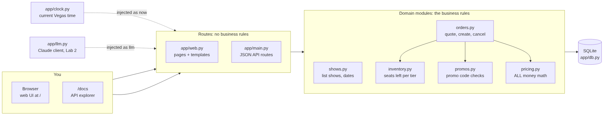
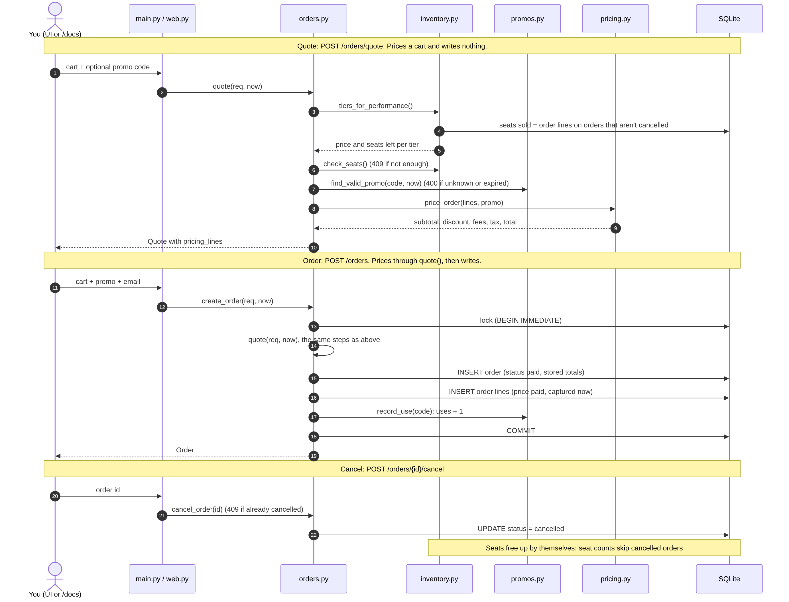
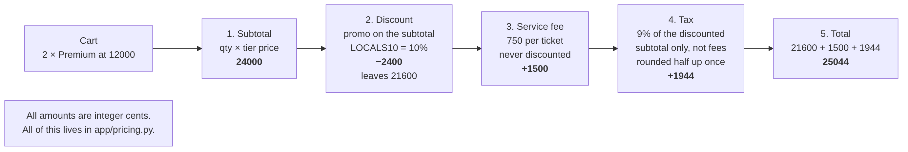
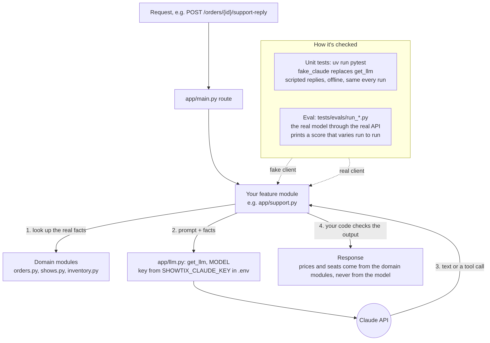
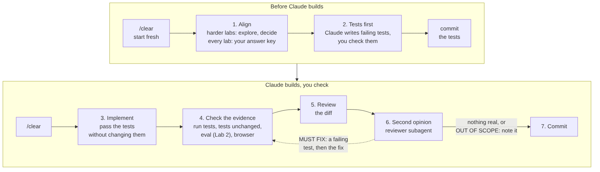

# How ShowTix fits together

Five pictures of the app and the way we work on it. Read this before your first lab, or whenever a sheet sends you into code you haven't seen. Each picture has a source file in [`diagrams/`](diagrams/) (Mermaid text, which Claude can read too).

## 1. How a request flows through the app

- **Routes hold no business rules.** `app/main.py` (the JSON API) and `app/web.py` (the pages) read the request, call a domain module, and return what it gives back. A checkbox on every sheet checks this.
- **The rules live in the domain modules.** `orders.py` runs quote, order and cancel, and calls the other three.
- **All money math is in `pricing.py`.** Nothing else adds, discounts or taxes money.
- **Time and the Claude client are injected.** Routes get the current time from `clock.py` and the Claude client from `llm.py` (Lab 2), so tests can swap in a fixed time and a fake Claude.

## 2. Quote, order, cancel

- **A quote writes nothing.** It checks seats and the promo code, then prices the cart.
- **An order prices itself by calling `quote()`,** then writes the order, its lines (with the price paid, captured now) and one promo use, all inside one lock.
- **Seats are never stored as a count.** Seats sold is the sum of order lines on orders that aren't cancelled, so cancelling an order frees its seats with no extra code.
- Labs 1b, 1d, 1e and 1f all change something in this picture.

## 3. How a price is built

- **The order of these five steps is the core rule of the app.** It's also in `CLAUDE.md`.
- **The promo discounts the subtotal only.** The $7.50 service fee is never discounted.
- **Tax is 9% of the discounted subtotal, not the fees,** rounded half up to the cent once.
- **Every amount is integer cents.** Use this example to check your own answer key: 2 Premium with LOCALS10 totals 25044.

## 4. How a Lab 2 feature fits

- **Your feature gets the real facts from the domain modules first,** then sends them to Claude with the prompt.
- **Your code checks what comes back** before it reaches the customer. Prices and seats always come from the domain modules, never from the model.
- **Two kinds of checks.** Unit tests use `fake_claude`: scripted replies, offline, the same every run. The eval calls the real model and prints a score that can change from run to run.

## 5. The workflow

The workflow every sheet follows. [`tasks/00-how-we-work.md`](../tasks/00-how-we-work.md) explains each step and why; each sheet has the prompts.
