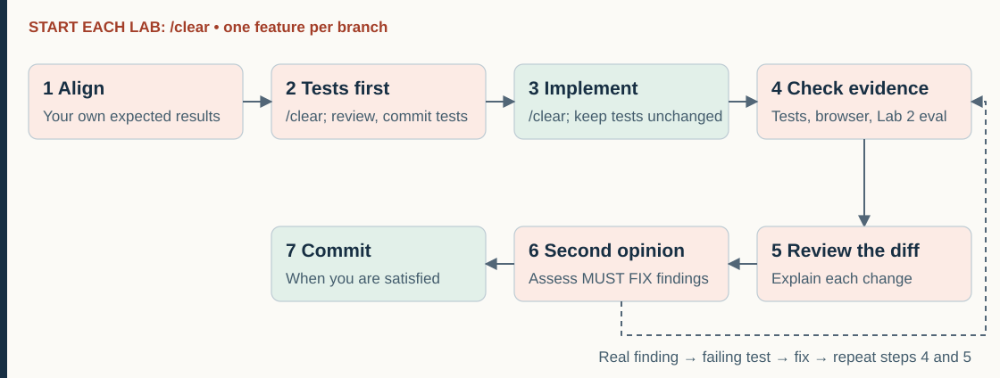

# How we work in these labs

Every lab uses the same seven-step workflow. This page explains each step and why it's good practice. For how to run commands and the app, see [Getting started](01-getting-started.md). Read it once before your first lab (about 5 minutes), then come back whenever a step is unclear. For diagrams of how the app itself works, see [`docs/architecture.md`](../docs/architecture.md). Your sheet has every prompt ready to copy, with its own file name filled in.

A note on words: you may read about "agent loops" elsewhere. That means something different: the model calling tools over and over until a task is done, which is what you build in Lab 2c. This page is about the workflow *you* follow.

## The workflow at a glance



The [detailed version](../docs/architecture.md#5-the-workflow) shows what happens in each step.

1. **Align: settle what "done" means.** On the harder labs, Claude first explains the code (1e, 1f, 2c) and you settle the open decisions with it. Every lab ends step 1 with your expected results, written without Claude
2. **Tests first:** `/clear`, then Claude writes failing tests, you check them against your expected results, then you commit them
3. **Clear, then implement:** `/clear`, then Claude makes your tests pass without changing them
4. **Check the evidence:** run the tests yourself, confirm they weren't changed, and try it in your browser
5. **Review the diff**
6. **Get a second opinion** from a reviewer subagent, then fix what's real
7. **Commit** when you're satisfied with the change

Start every lab with `/clear`, so Claude doesn't carry anything over from the last one.

## 1. Align: settle what "done" means

Before Claude writes anything, you agree on exactly what the feature should do. Every lab's step 1 ends with your expected results. On the harder labs, two parts come first, in this order: explore, then decide.

### Explore (the Breakthrough and Advanced labs: 1e, 1f, 2c)

You can't decide how to change code you've never seen. Your sheet's first prompt asks Claude to explain the part of the code you'll change, in plain words, short enough to read in 2 minutes. It also lists every route and page form that leads to that code, so the proposal can cover each. It changes nothing. For the big picture, see [`docs/architecture.md`](../docs/architecture.md).

### Decide (the Intermediate labs and up)

- **Sheets with "Decisions to make"** (1e, 1f, 2c): have Claude propose an answer to every decision in one message, then correct the picks you disagree with. For example:

  ```text
  Read tasks/lab1e-waitlist.md and the relevant code. Work through the
  "Decisions to make" for me in one message: for each bullet, your pick in one
  line, why, and the alternative you rejected. If a pick depends on how the code
  works, explain that part in plain words first. Then imagine this shipped and a
  customer hit a problem: name the three most likely things our picks don't
  cover and say which one, if any, you'd make a criterion. Don't write any code
  or tests. End by asking me which picks to change. Once I've answered, replace
  the placeholder criteria (3 onward) in Acceptance criteria with at most 5 new
  criteria: one numbered, testable criterion each, describing behavior rather
  than which functions to create, with exact status codes and messages; under
  each, a "Why:" line with the reason we chose it; right after them, a short
  "Not doing" list for everything we deferred, including problems we didn't make
  criteria; and last, a "Slices" list of at most 3 vertical slices (each a piece
  of behavior that works end to end, small enough to review in a few minutes),
  in build order, with the criteria each covers. Then replace everything under
  the Decisions to make heading (the intro sentence, the bullets and the
  paragraph after them) with one line: "Decided: see criteria 3 onward, each
  with its Why. Deferred items are under Not doing." Change nothing else in the
  sheet. Show me what you changed so I can check it.
  ```

  You still choose, by exception: reply with the picks to change ("Change 2 to the simplest option. Keep the rest.") or "Keep all your picks." The proposal ends with a pre-mortem: what could a customer still run into? The caps (5 new criteria, 3 slices) keep the build inside the lab; anything that doesn't fit goes on Not doing. Spend about 15 minutes on exploring and the proposal together.
- **Sheets that ask for your own edge cases** (1c, 1d, 2b): think them through yourself first and type them into the sheet. Stuck? Ask Claude for a hint:

  ```text
  Read tasks/lab1c-group-discount.md and the relevant code. I'm stuck finding edge cases
  the criteria don't cover. Give me one hint at a time, as a question, not the
  edge case itself. If I say "just tell me", suggest 3 edge cases, one sentence
  each, and I'll pick. Don't write any code or change any files.
  ```

**Why the decisions go in the sheet:** a file survives `/clear`; the conversation doesn't. You'll `/clear` before writing tests and again before implementing, so the sheet and your committed tests are everything the next session knows.

### Expected results (every lab, without Claude)

Your expected results are just a list of what should happen for each acceptance criterion. A few lines per criterion is enough. Keep them wherever you like.

Go through the sheet's **Acceptance criteria** one by one, including any you just added, and write down exactly what should happen for each: which shows come back, which status code, the exact message, the exact cents. The data the app starts with (every show, night, price, seat count, promo code and seeded order, plus how a price is built) is in [`docs/seed-data.md`](../docs/seed-data.md). If Claude wrote exact values into your new criteria, check them yourself there or in /docs rather than copying them.

**Why:** Claude is fast and sounds confident, and it writes tests that agree with its own understanding. If you don't know the right answer before you see Claude's, you can't tell a test that checks the right thing from one that checks the wrong thing. While this app was being built, Claude once added 36000 + 2250 + 3240 and got 40590. The right answer is 41490. Expected results catch that; nodding along doesn't.

Acceptance criteria are the definition of "done." Turning each one into an exact expected value is what makes it testable. On the Starter labs, this is all of step 1: aligning means agreeing with yourself on what right looks like, before Claude does anything.

## 2. Tests first

Type `/clear`, then ask Claude for the tests, and only the tests:

```text
Read tasks/lab1a-category-filter.md and the relevant code. Write a failing
test for each acceptance criterion. Test behavior through the API, the pages,
or functions that already exist, not new functions or exact HTML. Don't change
anything in app/. Run the tests and show me which ones fail.
```

Compare each test with your expected results. Same shows, same status code, same message, same cents? A test that checks "the total got smaller" instead of "the total is 25044" is a weak test. And a test should check behavior through the API or the page, not call a function that doesn't exist yet: a test like that designs the code for Claude, and step 3 won't let Claude change it. If one is wrong, tell Claude what it should be and why:

```text
The test for criterion 4 expects ___, but it should be ___ because ___. Fix
that test.
```

When you're satisfied with the tests, commit them:

```text
! git add -A && git commit -m "lab1a: tests"
```

**Why:**

- **A test that has never failed proves nothing.** It might not test anything at all. A test that fails first proves it can detect the missing behavior; when it passes after the change, you know *your change* made it pass. This is called red, then green.
- **Checking tests is easier than checking code.** Each test is one criterion with one expected result, so you can hold it against your expected results line by line. Once the tests are right, they're the target Claude works toward.
- **Committing them makes them tamper-evident.** If a test is awkward to pass, an AI can quietly loosen it. Once your reviewed tests are committed, any later change to them shows up in `git diff`.
- **A test that already passes isn't always a mistake.** If the behavior exists today (a request without the new filter returns everything, as before), the test should pass. Your sheet says when to expect that.

## 3. Clear, then implement

Type `/clear`, then:

```text
Make the new tests from my last commit pass (see git show HEAD). Don't change
any test. If you change anything the tests don't need, tell me what and why.
Read tasks/lab1a-category-filter.md for context. Run the full suite and show
me the output.
```

**Big features: one vertical slice at a time.** On the Breakthrough and Advanced labs, step 1 ends with a Slices list in the sheet, based on what you decided; step 3 builds them in that order, and Claude stops after each one. How many slices depends on the feature: each one should work end to end and be small enough to review in a few minutes. A *vertical* slice is a piece that works end to end, such as "customers can join the waitlist", not a layer such as "all the database code". After each slice, read its diff, commit it, then ask for the next.

**Why slices?** One feature built in one go can touch seven files at once, and a diff that big is too large to review honestly. Slices keep each diff small enough to read, give you a commit to go back to if the next slice goes wrong, and catch a misunderstanding after one slice instead of after the whole feature is built on it. Tests for later slices fail until their slice is built; that's expected. On a real project, you'd usually go one step further: write and review the tests for each slice just before building it. Here, the whole feature's tests come first to save time.

**Why:**

- **`/clear` gives the implementing session a clean start.** It works from your sheet and your committed tests, not from a long conversation full of options you didn't choose.
- **"Don't change any test":** your tests are the definition of done. The code moves to meet them, not the other way around.
- **"Run the full suite":** your change can break something somewhere else. That's called a regression. The full suite runs in a few seconds, so always run all of it, not just your new tests.
- **"Show me the output":** evidence, not claims. "All tests pass" on its own tells you very little; the actual output tells you what ran and what happened.

## 4. Check the evidence

Don't take Claude's word for it. The `!` runs a command yourself, not through Claude, and Claude sees the output too.

- **Run the tests yourself.** The last line should say only `passed`, with no `skipped`, `deselected` or `xfailed`:

  ```text
  ! uv run pytest
  ```

- **Check that Claude only changed app code.** Every file this lists should be under `app/`:

  ```text
  ! git status --short
  ```

  A file in `tests/` (changed, or new with `??`), a `conftest.py`, or `pyproject.toml` means Claude touched your tests or how they run: ask why. On labs built slice by slice (1e, 1f, 2c), also check the slice commits: [Check your tests didn't change](01-getting-started.md#check-your-tests-didnt-change).
- **Lab 2 only: run your eval** twice and read any failing case before changing anything. Your sheet explains how.
- **Try it yourself.** On 1a and 1b, your sheet's **Check it in your browser** section has the exact links, clicks and results to expect. On later labs, choose your own checks from your expected results. To start and stop the app, see [Start the app](01-getting-started.md#start-the-app) and [Stop the app](01-getting-started.md#stop-the-app).

Use the values from your expected results. Does the running app agree?

**Why `git status`, not `git diff`?** `git diff` only shows files git already tracks, so a new test file or a new `conftest.py` that skips tests wouldn't show up. And test settings can live outside `tests/`, in `pyproject.toml`.

## 5. Review the diff

See everything that changed, including new files.

```text
! git add -A && git diff --staged
```

Or use the **Source Control** panel in VS Code, which shows the same thing side by side. `git status` gives just the list of changed files. Your tests are already committed, so this shows only the code Claude wrote.

Ask yourself: can I explain every change? Did anything change that has nothing to do with this feature? (`git add -A` only stages; it doesn't commit anything.)

## 6. Get a second opinion

Have a subagent review the work. It starts with a fresh context, so it hasn't seen your conversation and can't be talked into agreeing with it:

```text
Use a subagent to review this branch's changes (git diff main) against
tasks/lab1a-category-filter.md. It hasn't seen our conversation. It should
check every acceptance criterion, not report style, and not change any files
or the database. Show me its findings as a numbered list, each with:
- a label: MUST FIX (a criterion isn't met, or a bug), OUT OF SCOPE (real, but
  not in the criteria, or already there before this branch), UNSURE, or
  OPTIONAL
- which criterion it's about
- evidence: the file and line, or an input that gives the wrong result

To keep it simple, after you categorize the findings only show MUST FIX. All
other findings you can ignore.

Then ask me which ones to fix. For each one I pick, write a failing test that
shows the problem, then fix it. Run the full suite and show me the output.
```

**Why "don't report style"?** A reviewer asked to find problems always finds something. If you fix every finding, you end up with extra layers of code and tests for cases that can't happen. You want bugs and unmet criteria, not someone else's taste.

**What to do with the findings.** Claude shows the MUST FIX findings as a numbered list and asks which to fix. The labels are the reviewer's opinion, so check the evidence yourself before you answer.

Answer with the numbers you want fixed, for example "1 and 3". Claude writes a failing test for each one, then fixes it. You can also decide not to fix one, or talk it through with Claude before you decide.

Then repeat steps 4 and 5. One review round is enough unless the fixes were big.

## 7. Commit

When you're satisfied with the change:

```text
! git add -A && git commit -m "lab1a: category filter"
```

On labs built slice by slice, your slices are already committed. If you didn't fix anything in step 6, there's nothing left to commit.

**Why:** a commit is a safe point. If anything goes wrong later, you can get back here.

## When Claude gets something wrong

Find out why before you correct it. Press Esc to stop it if it's still going, then:

1. **Ask first:** "What did you understand the requirement to be, and what in the sheet or code led you there?" Its answer usually shows the misunderstanding: a sentence it misread, or a pattern in the code it copied. Do this the first time, not after several tries; it's the fastest way to the fix.
2. **Correct it with the reason:** say what you want and why. "Cap only the service fees, not the total, because tax and ticket prices are separate charges" works better than "don't do that."
3. **Still wrong after that?** The conversation is now full of wrong turns. Type `/clear` (it wipes the conversation, which is why you ask first) and start the step over with your sheet's prompt plus three additions:
   - **The rule it got wrong, stated as what you want, with the reason.**
   - **One example from your expected results,** with the exact result.
   - **Where the change belongs**, if Claude put it somewhere else.

   For example, for the fee cap from Demo 1:

   ```text
   Make the new tests from my last commit pass (see git show HEAD). Don't change
   any test. If you change anything the tests don't need, tell me what and why.
   Important: cap only the service fees, not the total or the tax, because tax
   and ticket prices are separate charges. For example, 8 tickets have fees of
   3000 cents (not 6000), and their tax doesn't change. All of the money math
   belongs in app/pricing.py. Run the full suite and show me the output.
   ```
4. **If it's a rule for the whole project,** add it to `CLAUDE.md` so every session knows it.

Also: one feature per branch, small changes. Small diffs are easy to review and easy to undo.

## When you're stuck

Each sheet ends with a link to its hints: three levels, from a gentle nudge to a near-answer. Open one level at a time, and only after you've tried without it. Still stuck? Raise your hand.

## Commands

How to run a command yourself, run the tests, start and stop the app, reset the database, and use git: [Getting started](01-getting-started.md).

## Appendix: sources behind the workflow

This workflow isn't ours alone. Each step follows advice from the people who build and use coding agents most. Quotes and links were checked on Nov 3, 2026.

**Anthropic's own guidance:** [Best practices for Claude Code](https://code.claude.com/docs/en/best-practices). The older Anthropic engineering post on the same topic now redirects here.

| Step | What the page says | Section |
| --- | --- | --- |
| 1. Align | "Interview me until you could write the spec, then write it to SPEC.md." Then "start a fresh session to build from it, so the build begins with a clean context and a written definition of done." | Brainstorm with Claude first |
| 2. Tests first | Its example of a good prompt: "write a failing test that reproduces it, then fix it." | Write a specific prompt |
| 3. Clear | "`/clear` between unrelated tasks … a focused context gets you better answers." | Keep cost and context down |
| 4. Evidence | "Ask Claude for *evidence*: the command it ran and its output … 'All tests pass' on its own tells you very little." | Give Claude a check to run |
| 6. Second opinion | `/code-review` "reviews the diff in a fresh subagent that never saw your conversation." Subagents help when "getting a reviewer that hasn't seen how the code was written." | Give Claude a check to run; Know what subagents cost |
| 6. "Don't report style" | "A reviewer that's asked to find problems will always find *something*. If you fix every finding, you end up with extra abstraction layers and tests for cases that can't happen." | Review against your spec |
| When Claude goes wrong | "After two failed corrections run `/clear` and write a better prompt instead of a third." We go one step further: ask why on the first miss. | Steer the session |

**Other sources, by step:**

- **1. Align: explore before deciding.** Dex Horthy (HumanLayer), [Getting AI to Work in Complex Codebases](https://github.com/humanlayer/advanced-context-engineering-for-coding-agents/blob/main/ace-fca.md) (Aug 29, 2025): research first, to "understand the codebase, the files relevant to the issue, and how information flows," because a misunderstanding there "could land you with thousands of bad lines of code." His 2026 revision adds questioning first: [Lessons Learned Rolling Out RPI to Hundreds of Engineers](https://www.youtube.com/watch?v=YwZR6tc7qYg) (Mar 24, 2026) and [Everything We Got Wrong About Research-Plan-Implement](https://www.youtube.com/live/6IxSbMhT7v4?t=1947) (Apr 20, 2026).
- **1. Align: the interview and the spec.** Matt Pocock, [mattpocock/skills](https://github.com/mattpocock/skills): `/grill-me`, "Get relentlessly interviewed about a plan or design until every branch of the design tree is resolved," and `/to-spec`, "Turn the current conversation into a spec."
- **1. Align: plan before you build.** Simon Willison, [Vibe engineering](https://simonwillison.net/2025/Oct/7/vibe-engineering/) (Oct 7, 2025): "Sitting down to hack something together goes much better if you start with a high level plan."
- **2. Tests first.** Jesse Vincent, [Superpowers](https://github.com/obra/superpowers): "write failing test, watch it fail, write minimal code, watch it pass, commit." Kent Beck's system prompt in [Augmented Coding: Beyond the Vibes](https://newsletter.kentbeck.com/p/augmented-coding-beyond-the-vibes) (Jun 25, 2025): "Always follow the TDD cycle: Red → Green → Refactor." The classic book is Kent Beck, *Test-Driven Development: By Example* (2002).
- **2. Test behavior, not implementation.** Andrew Trenk, [Testing on the Toilet: Test Behavior, Not Implementation](https://testing.googleblog.com/2013/08/testing-on-toilet-test-behavior-not.html) (Google Testing Blog, Aug 5, 2013): "Tests that are independent of implementation details are easier to maintain."
- **2. Commit your tests so changes show.** Kent Beck, in the same essay, lists a warning sign to watch for: "Any indication that the genie was cheating, for example by disabling or deleting tests." Committing the reviewed tests makes that kind of cheating visible in `git diff`. That part is our own practice, from our dry runs.
- **3. Vertical slices.** Addy Osmani, [agent-skills](https://github.com/addyosmani/agent-skills): "Thin vertical slices - implement, test, verify, commit." Matt Pocock's `/tdd` "builds features or fixes bugs one vertical slice at a time," and his `/to-tickets` breaks a spec into "tracer-bullet tickets."
- **4. Check the evidence.** Boris Cherny, who created Claude Code, in [Inside the Development Workflow of Claude Code's Creator](https://www.infoq.com/news/2026/01/claude-code-creator-workflow/) (InfoQ, Jan 10, 2026): the most important tip is to "give Claude a way to verify its work," which he says improves the result 2–3 times. Simon Willison: with a good test suite, "agentic coding tools can *fly*."
- **5. Review the diff.** Addy Osmani, [The 70% Problem](https://addyosmani.com/agentic-engineering/the-70-percent-problem/): "AI gets you 70% of the way fast. The remaining 30% is where experienced engineers earn their keep." Simon Willison: "If you're fast and productive at code review you're going to have a much better time working with LLMs."
- **6. A second opinion.** Superpowers runs code review "between tasks," reporting issues "by severity," and "critical issues block progress."
- **7. Commit.** Simon Willison: "Being able to undo mistakes and understand when and how something was changed is even more important" with agents.
- **Why there's no plan-mode step.** In January 2026, Boris Cherny described starting in plan mode (InfoQ, above). By September he wrote, on [Hacker News](https://news.ycombinator.com/item?id=49840054), "plan mode was useful, and is no longer useful," agreeing with Ayman Nadeem's [Plan mode is dead](https://www.aymannadeem.com/artificial/intelligence,/developer/tools/2026/09/24/plan-mode-is-dead.html) (Sep 24, 2026). In our workflow, the proposal round and the test review do that job.
