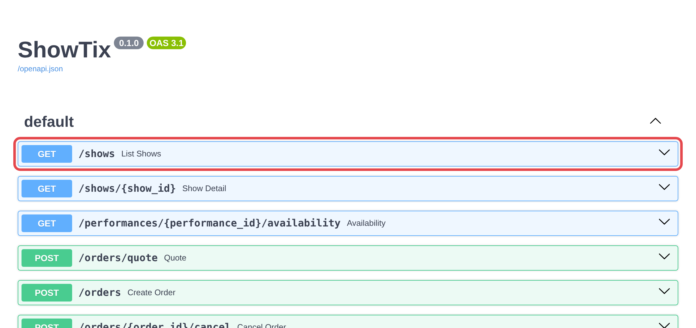
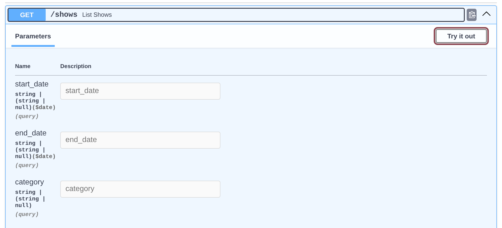
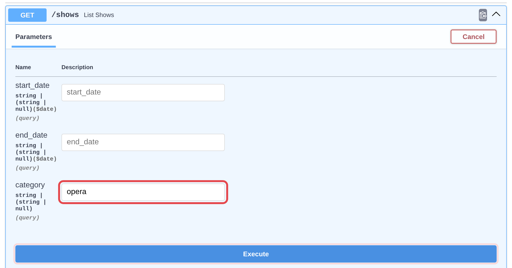
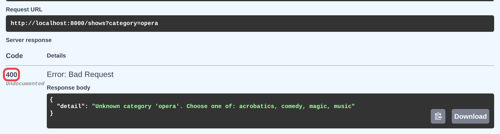
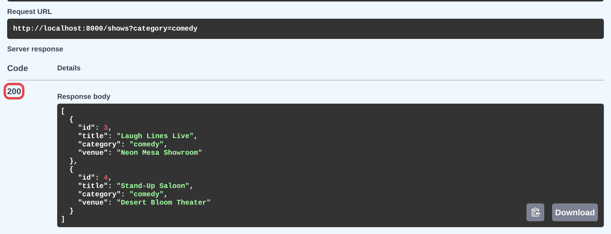

# Lab 1a: Category filter

- **Tier:** Starter
- **Time:** 50 minutes
- Solo or with a partner

## Start here

**New here?** Read [Getting started](01-getting-started.md) for running commands and the app, then [How we work](00-how-we-work.md) for the workflow (about 5 minutes).

**Your first lab:** a small filter, built with the full workflow.

1. Run the command under [Starting branch](#starting-branch).
2. Read [Goal](#goal), [Background](#background) and [Acceptance criteria](#acceptance-criteria).
3. Follow [The workflow](#the-workflow) step by step.

**Step 1 is yours:** write out (or think about) your expected results before you ask Claude anything.

**You're done when you can check every box under [Checklist: What Done Means](#checklist-what-done-means).**

**Extra time?** Try the [Optional stretch](#optional-stretch). Stuck? See [Hints](#hints).

## Goal

#### Let customers list shows by category: `GET /shows?category=comedy`.

## Starting branch

Copy the command below and run in Claude Code

```text
! git switch main && uv run python -m app.seed && git switch -c lab1a-category-filter && uv run pytest
```

Here's what it does:

1. Switches to `main`, so the new branch starts from the original code
2. Resets the database to the seed data
3. Creates new feature branch `lab1a-category-filter` from `main`
4. Runs the tests

Every test should pass before you change anything.

**Trouble?** See [Start a lab branch](01-getting-started.md#start-a-lab-branch).

## Background

Here is the relevant background about the feature you'll be building:

- `GET /shows` already takes `start_date` and `end_date`. The route is in `app/main.py`; the query is built in `shows.list_shows()` in `app/shows.py`.
- Every show has one of four categories, `magic`, `comedy`, `music` or `acrobatics`, and the seed data has exactly 2 of each. Every show plays nightly from Nov 10 to Nov 23, 2026 (all of it is in [`docs/seed-data.md`](../docs/seed-data.md)).
- Domain code reports bad input by raising `BadRequest` from `app/errors.py`, which becomes a 400.

**For an illustration of the request flow through these files, see [`docs/architecture.md`](../docs/architecture.md).**

## Acceptance criteria

In this lab, the full criteria are given below.

**Every criterion needs at least one test.**

1. `GET /shows?category=comedy` returns exactly `Laugh Lines Live` and `Stand-Up Saloon`, ordered by title.
2. Each of the four categories returns exactly its 2 shows.
3. Matching ignores case: `?category=Comedy` returns the same 2 shows as `?category=comedy`.
4. Without `category`, `GET /shows` returns all 8 shows, as before.
5. Category combines with dates: `?category=music&start_date=2026-11-20` returns both music shows; `?category=music&start_date=2026-11-24` returns `[]`.
6. An unknown category returns 400 with the detail `Unknown category 'opera'. Choose one of: acrobatics, comedy, magic, music`.
7. `category` shows up as an optional query parameter in /docs (test it through `client.get("/openapi.json")`).

## The workflow

#### Introduction

There are many workflows out there.

Engineers are still experimenting and finding what works for them. The models are changing and improving so rapidly that what works great today may get discarded 3 months from now (or, next week). You'll probably come up with your own workflow eventually (or maybe you already have one). All we're doing here is introducing you to one way you can build good software reliably with a coding agent like Claude.  

The main takeaway is this: there is no "correct" way right now.

- There are things you should do.
- There are things you shouldn't do. 
- There are things that seem to work in certain situations with the models we have right now.

The workflow in this lab is based on general software engineering principles that have been around for decades, combined with best practices given by Anthropic (and others).

We encourage you to use what works for you and share your results.

**<ins>One thing to note:</ins>** Often people who work with Claude (or Codex, etc...) first get alignment on an idea, have Claude put that into a spec, and create work items (user stories, issues, etc...) for Claude to work on *before* steps 2-7. Since this is a lab and we have limited time, we're focusing on the coding and review aspects of the flow. But we highly recommend you get experience with this on your own time.

#### Workflow Overview

1. Start a fresh conversation. Write your expected results (no Claude yet).
2. Start a fresh conversation. Claude writes failing tests. You check them against your expected results, then commit.
3. Start a fresh conversation. Claude makes the tests pass without changing them.
4. Check the evidence: run the tests, confirm only app/ changed, try it in the browser.
5. Review the diff.
6. A subagent reviews the change. For each real bug, Claude writes a failing test and fixes it, then you repeat steps 4 and 5.
7. Commit.

Why each step matters: [How we work](00-how-we-work.md).

### Step 1. Alignment on what "done" means (no Claude yet)

#### 1a. Start with a fresh conversation

```text
/clear
```

#### 1b. Review the acceptance criteria

This is how Claude knows when the feature is complete. Think through exactly what each criterion should return before Claude writes anything.  
Make a note of this somewhere to refer to later (like notes, notepad, or an empty text file. Whatever works for you).

**Go through [Acceptance criteria](#acceptance-criteria) one by one:** which shows come back, in what order, which status code, the exact message.

**Note:**

- All seed data is in [`docs/seed-data.md`](../docs/seed-data.md) for your convenience. For example, which 2 shows are in each category.
- Want to see it in the running app? See [Start the app](01-getting-started.md#start-the-app) and [Try an endpoint in /docs](01-getting-started.md#try-an-endpoint-in-docs).

### Step 2. Implement tests first

#### 2a. Start with a fresh conversation

```text
/clear
```

#### 2b. Have Claude write failing tests. Check them against your expected results

```text
Read tasks/lab1a-category-filter.md and the relevant code. Write a failing
test for each acceptance criterion. Test behavior through the API, the pages,
or functions that already exist, not new functions or exact HTML. Don't change
anything in app/. Run the tests and show me which ones fail.
```

#### 2c. Manually check the tests Claude just created

- **Compare each test with your expected results from step 1.**
- **Tests must check behavior through the API or the page**, **<ins>not functions that don't exist yet</ins>**.   
A test that calls a new function is designing the code for Claude.
- **Criterion 4 already passes before you build anything:** without the `category` parameter, `GET /shows` already returns all 8 shows.   
**That's expected**; the test guards behavior your change <ins>must not</ins> break.
- **Criterion 6's test checks the exact message**, not just the 400.

#### 2d. If a test doesn't match your expected results, tell Claude what it should be and why

```text
The test for criterion 4 expects ___, but it should be ___ because ___. Fix
that test.
```

**Example:**

```text
The test for criterion 6 expects the error message to be "Unknown category
'opera'", but it should be "Unknown category 'opera'. Choose one of:
acrobatics, comedy, magic, music" because the error should list the available
categories. Fix that test.
```

#### 2e. Commit the test code

When every test matches your expected results, commit them:

```text
! git add -A && git commit -m "lab1a: tests"
```

### Step 3. Make the tests pass (write the code)

#### 3a. Clear the conversation

To get good results, Claude should build from the "spec" and your committed tests (not all the context from that chat):

```text
/clear
```

#### 3b. Ask Claude to make the tests pass

```text
Make the new tests from my last commit pass (see git show HEAD). Don't change
any test. If you change anything the tests don't need, tell me what and why.
Read tasks/lab1a-category-filter.md for context. Run the full suite and show
me the output.
```

Claude shouldn't touch any test file.

We don't want to rewrite tests we've already verified to make them pass. The code alone should do that. Step 4 checks it.

### Step 4. Check the evidence

Don't take Claude's word for it; check for yourself.

#### 4a. Run the tests

The last line should say only `passed`, with no `skipped`, `deselected` or `xfailed`:

```text
! uv run pytest
```

#### 4b. Check that Claude only changed app code

This shows the files that have changed since the last commit.  
Every file this lists should be under `app/`:

```text
! git status --short
```

A file in `tests/` (changed, or new with `??`), a `conftest.py`, or `pyproject.toml` means Claude touched your tests or how they run: ask why before going on. If there are any fixes in step 6, the only test changes should be the new tests you asked for. Nothing existing should be modified.

#### 4c. Visual tests in the browser

Try it yourself: follow [Check it in your browser](#check-it-in-your-browser) below.

#### 4d. Something doesn't match?

Tell Claude which criterion failed and what you saw.

### Step 5. Review the diff

#### 5a. Read every change Claude made before you accept it

These commands stage the changes and then show the diff between these staged changes and the latest commit on your branch.

```text
! git add -A && git diff --staged
```

- Can you explain every change?
- Was anything touched that has nothing to do with categories?
- Prefer side by side? Use VS Code's **Source Control** panel.

Your tests are already committed, so this shows only the code Claude wrote.

### Step 6. Get a second opinion

#### 6a. Create a code reviewer for your changes

Ask Claude to create a reviewer subagent. It hasn't seen your conversation, and it checks the change against this sheet.

```text
Use a subagent to review this branch's changes (git diff main) against
tasks/lab1a-category-filter.md. It hasn't seen our conversation. It should
check every acceptance criterion, not report style, and not change any files
or the database. Show me its findings as a numbered list, each with:
- a label: MUST FIX (a criterion isn't met, or a bug), OUT OF SCOPE (real, but
  not in the criteria, or already there before this branch), UNSURE, or
  OPTIONAL
- which criterion it's about
- evidence: the file and line, or an input that gives the wrong result

To keep it simple, after you categorize the findings only show MUST FIX. All
other findings you can ignore.

Then ask me which ones to fix. For each one I pick, write a failing test that
shows the problem, then fix it. Run the full suite and show me the output.
```

Claude shows the MUST FIX findings and asks which to fix. The labels are the reviewer's opinion, so check the evidence yourself before you answer.

#### 6b. Answer with the numbers you want fixed

For example "1 and 3". Then repeat steps 4 and 5.   
Or you can decide you don't want to fix it, or you want to have a chat with Claude about it before you decide.

Why "don't report style"? See [step 6 of How we work](00-how-we-work.md#6-get-a-second-opinion).

### Step 7. Commit

Commit when you're satisfied with the change:

```text
! git add -A && git commit -m "lab1a: category filter"
```

### Finished with time to spare?

Try the [Optional stretch](#optional-stretch) below.

## Check it in your browser

Use this for step 4c of the workflow.

Compare what you see with your expected results.

### 1. Start the app

Ask Claude to start the app in the background ([more on starting the app](01-getting-started.md#start-the-app)):

```text
Start the app in the background with uv run uvicorn app.main:app --reload,
and tell me when it's ready.
```

Wait until Claude says it's ready, then keep working in the same conversation.

### 2. Open each link (criteria 1–5)

Open each link in your browser. In Chrome or Edge, tick **Pretty-print** to make the result easier to read.

| Criterion | Open | You should see |
| --- | --- | --- |
| 1 | [http://127.0.0.1:8000/shows?category=comedy](http://127.0.0.1:8000/shows?category=comedy) | Exactly 2 shows: `Laugh Lines Live`, then `Stand-Up Saloon` |
| 2 | [http://127.0.0.1:8000/shows?category=magic](http://127.0.0.1:8000/shows?category=magic) | `Smoke & Sleight`, then `The Vanishing Ace` |
| 2 | [http://127.0.0.1:8000/shows?category=music](http://127.0.0.1:8000/shows?category=music) | `Desert Strings`, then `Neon Nights Revue` |
| 2 | [http://127.0.0.1:8000/shows?category=acrobatics](http://127.0.0.1:8000/shows?category=acrobatics) | `Gravity Optional`, then `Skyline Circus` |
| 3 | [http://127.0.0.1:8000/shows?category=Comedy](http://127.0.0.1:8000/shows?category=Comedy) | The same 2 shows as criterion 1 |
| 4 | [http://127.0.0.1:8000/shows](http://127.0.0.1:8000/shows) | All 8 shows |
| 5 | [http://127.0.0.1:8000/shows?category=music&start_date=2026-11-20](http://127.0.0.1:8000/shows?category=music&start_date=2026-11-20) | `Desert Strings`, then `Neon Nights Revue` |
| 5 | [http://127.0.0.1:8000/shows?category=music&start_date=2026-11-24](http://127.0.0.1:8000/shows?category=music&start_date=2026-11-24) | `[]` (nothing plays after Nov 23) |

**Tip:** open the criterion 1 link *before* you build the feature. You'll get all 8 shows, because the app silently ignores parameters it doesn't know. That's why your tests have to fail first.

### 3. Check the error and the parameter in /docs (criteria 6–7)

A browser link shows the error message but not the status code, so use /docs for these two.

1. Open [http://127.0.0.1:8000/docs](http://127.0.0.1:8000/docs) and click **GET /shows**.

   

2. **Criterion 7:** under **Parameters**, `category` is listed next to `start_date` and `end_date`, with no `* required` marker. Click **Try it out**.

   

3. Type `opera` in the **category** box and click **Execute**.

   

4. **Criterion 6:** scroll down to **Server response**. The code is **400**, and the response body's detail is exactly `Unknown category 'opera'. Choose one of: acrobatics, comedy, magic, music`.

   

5. Change `opera` to `comedy` and click **Execute** again. The code is **200**, with `Laugh Lines Live` and `Stand-Up Saloon`. The **Request URL** box shows the same link you opened in part 2.

   

**Something doesn't match?** Don't fix it by hand. Tell Claude which criterion failed and what you saw.

### 4. Stop the app

When you're done checking:

```text
Stop the app.
```

Other ways to stop it, and what "address already in use" means: [Stop the app](01-getting-started.md#stop-the-app).

## Checklist: What Done Means

- [ ] A test for each of the 7 criteria, all passing
- [ ] The tests you committed in step 2 weren't changed to make them pass
- [ ] Existing `tests/test_shows.py` tests pass unchanged
- [ ] Every test asserts exact values (exact cents for money), not "smaller" or "not empty"
- [ ] `uv run pytest` is fully green and still finishes in under 5 seconds
- [ ] Routes in `main.py` and `web.py` only call into domain modules
- [ ] You tried it by hand in the UI or /docs with values you worked out yourself
- [ ] You can explain every line of `git diff main`, and nothing unrelated changed

## Optional stretch

Finished early? Add a category dropdown to the home page (`GET /`) that filters the show list. The template only renders a form and the results; the filtering still happens in `shows.list_shows()`. Add a test that `GET /?category=comedy` lists only the two comedy shows.

## Hints

Stuck? Hints (nudge, stronger nudge, near-answer) are on the [workshop hints page](https://www.notion.so/409be0acdc2381a19172d05d8bc0cb5c). Open one level at a time.
