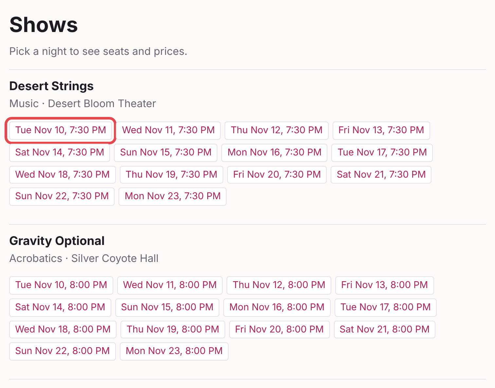
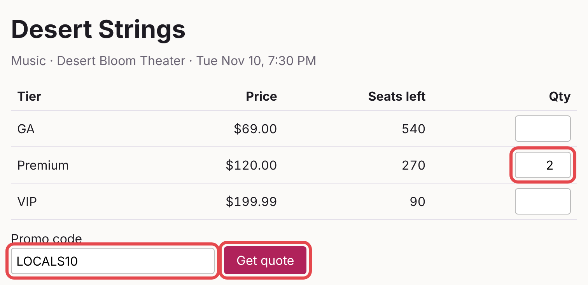
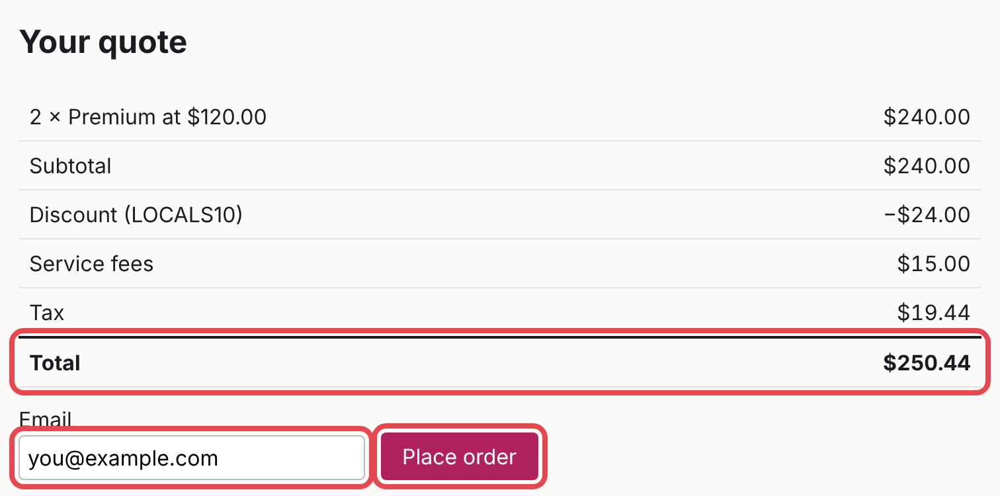
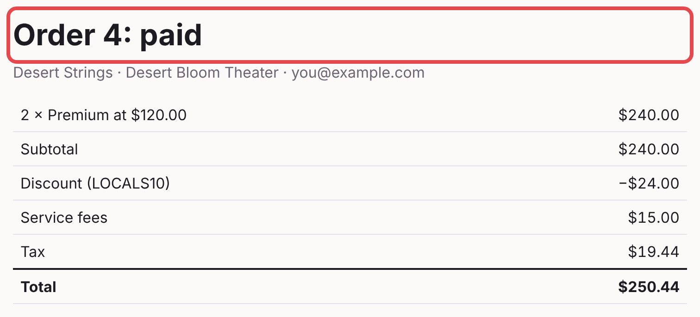
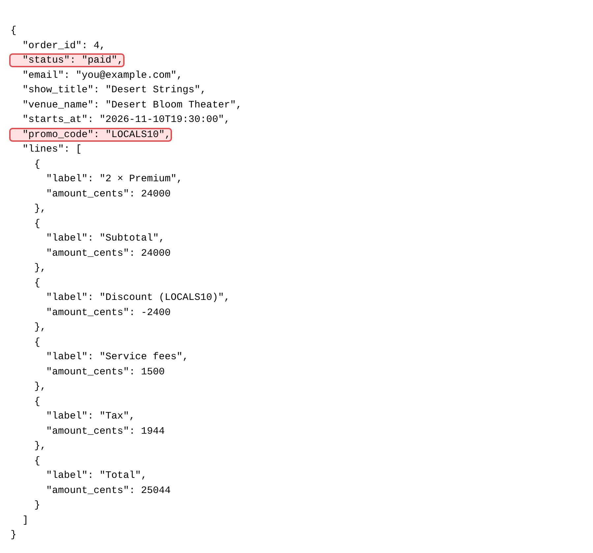
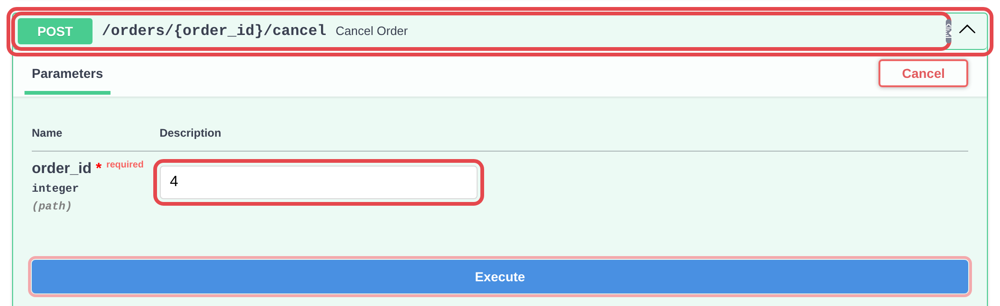
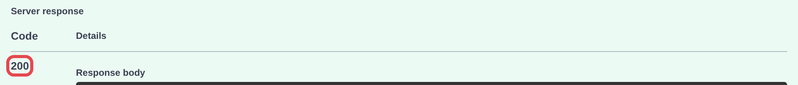
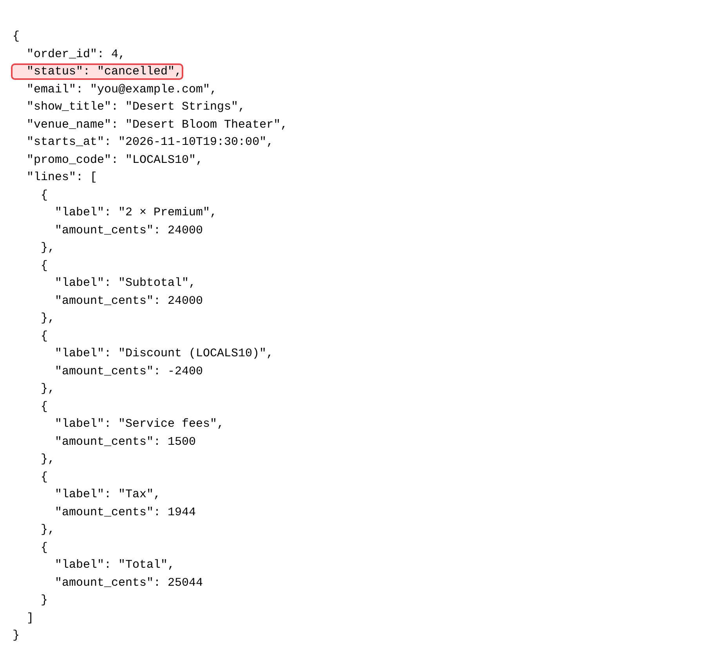
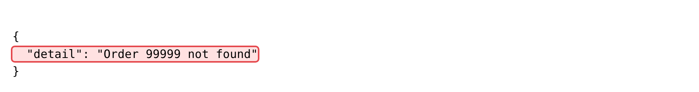

# Lab 1b: Itemized receipt

**Tier:** Starter · **Time:** 50 minutes · Solo or with a partner

## Start here

A small new endpoint that reads stored money, built with the full workflow.

1. New here? Read [Getting started](01-getting-started.md) for running commands and the app, then [How we work](00-how-we-work.md) for the workflow (about 5 minutes).
2. Run the command under [Starting branch](#starting-branch), then read [Goal](#goal), [Background](#background) and [Acceptance criteria](#acceptance-criteria).
3. Follow [The workflow](#the-workflow) step by step. Step 1 is yours: write your answer key before you ask Claude anything.

You're done when every box under [Done means](#done-means) is checked. Extra time? Try the [Optional stretch](#optional-stretch). Stuck? See [Hints](#hints).

## Goal

Add `GET /orders/{id}/receipt`: every pricing line of a stored order, matching its stored totals to the cent.

## Starting branch

Create this lab's branch from `main`, reset the database, and check that the tests pass:

```text
! git switch main && uv run python -m app.seed && git switch -c lab1b-itemized-receipt && uv run pytest
```

Every test should pass before you change anything. Trouble? See [Start a lab branch](01-getting-started.md#start-a-lab-branch).

## Background

Where the data you'll read lives:

- **An order stores its money when it's created:** `subtotal_cents`, `discount_cents`, `fees_cents`, `tax_cents`, `total_cents`, plus `promo_code` (null when no promo was used). Each order line stores `unit_price_cents`, the price paid. Tier prices can change later; receipts must not.
- **`orders.get_order()`** in `app/orders.py` already loads an order with its ticket `lines` and its `pricing_lines` (Subtotal, Discount, Service fees, Tax, Total), rebuilt from the stored totals. `shows.show_for_performance()` gives the show title and venue name (`.venue`), and `inventory.availability(conn, performance_id).starts_at` gives the start time.
- **`GET /orders/{id}`** is the UI's confirmation page (HTML, in `app/web.py`). The receipt is a new JSON endpoint next to it.

For a picture of how an order is created and stored, see [Quote, order, cancel](../docs/architecture.md#2-quote-order-cancel).

## Acceptance criteria

The full criteria are given. Write one test for each.

1. `GET /orders/{id}/receipt` returns 200 with `order_id`, `status`, `email`, `show_title`, `venue_name`, `starts_at`, `promo_code` and `lines`. `starts_at` uses the same format `GET /shows/{id}` returns.
2. `lines` is a list of `{"label": str, "amount_cents": int}` in this order: one line per tier bought, labelled like `2 × Premium` (the × sign, U+00D7, not the letter x); then `Subtotal`, `Discount`, `Service fees`, `Tax`, `Total`.
3. The discount line is negative. Its label names the promo when one was used (`Discount (LOCALS10)`); with no promo, it's `Discount` with amount 0.
4. Every amount comes from the stored order, not from recalculating. 2 Premium with LOCALS10 gives: `2 × Premium` 24000, `Subtotal` 24000, `Discount (LOCALS10)` -2400, `Service fees` 1500, `Tax` 1944, `Total` 25044.
5. The tier lines add up to `Subtotal`, and `Subtotal + Discount + Service fees + Tax` equals `Total`.
6. If the tier's price changes after the order, the receipt still shows the price paid.
7. A cancelled order still has a receipt, with `status` `cancelled`.
8. An unknown order id returns 404 with the detail `Order 99999 not found` (for id 99999), the message `orders.get_order()` already raises.

## The workflow

Settle what "done" means, then have Claude write the tests, check them yourself, and let Claude make them pass.

- Steps that use Claude have a prompt to copy; commands start with `!`.
- Why each step matters: [How we work](00-how-we-work.md).
- Start with a fresh conversation:

  ```text
  /clear
  ```

### 1. Align: write your answer key (no Claude yet)

Write down exactly what each criterion should return before Claude writes anything.

- Go through [Acceptance criteria](#acceptance-criteria) one by one: which status code, which fields, which labels, the exact cents.
- Work out criterion 4's example yourself and check you get the same numbers. Prices, fees and tax rules are in [`docs/seed-data.md`](../docs/seed-data.md).
- Want to see it in the running app? See [Start the app](01-getting-started.md#start-the-app) and [Try an endpoint in /docs](01-getting-started.md#try-an-endpoint-in-docs).

You'll compare Claude's tests against this answer key in step 2.

### 2. Tests first

Have Claude write failing tests, then check them against your answer key.

```text
Read tasks/lab1b-itemized-receipt.md and the relevant code. Write a failing
test for each acceptance criterion. Test behavior through the API, the pages,
or functions that already exist, not new functions or exact HTML. Don't change
anything in app/. Run the tests and show me which ones fail.
```

Check especially:

- **Tests check behavior through the API or the page**, not functions that don't exist yet. A test that calls a new function is designing the code for Claude.
- **Criterion 8 fails for the right reason.** Before the route exists, every receipt request returns FastAPI's generic `{"detail":"Not Found"}`. A test that checks only the 404 would pass already and prove nothing; one that checks the exact detail fails until your route is in place.
- **Criterion 6's test changes the tier's price *after* placing the order**, then checks the receipt still shows the old price. A test that never changes the price proves nothing.

If a test doesn't match your answer key, tell Claude what it should be and why:

```text
The test for criterion 4 expects ___, but it should be ___ because ___. Fix
that test.
```

When every test matches your answer key, commit them:

```text
! git add -A && git commit -m "lab1b: tests"
```

### 3. Clear, then implement

Clear the conversation, so Claude builds from the sheet and your committed tests, not the chat:

```text
/clear
```

Then ask:

```text
Make the new tests from my last commit pass (see git show HEAD). Don't change
any test. If you change anything the tests don't need, tell me what and why.
Read tasks/lab1b-itemized-receipt.md for context. Run the full suite and show
me the output.
```

Claude shouldn't touch any test file. Step 4 checks that.

### 4. Check the evidence

Don't take Claude's word for it; check for yourself.

- Run the tests. The last line should say only `passed`, with no `skipped`, `deselected` or `xfailed`:

  ```text
  ! uv run pytest
  ```

- Check that Claude only changed app code. Every file this lists should be under `app/`:

  ```text
  ! git status --short
  ```

  A file in `tests/` (changed, or new with `??`), a `conftest.py`, or `pyproject.toml` means Claude touched your tests or how they run: ask why before going on. After step 6's fixes, the only test changes should be the new tests you asked for.

- Try it yourself: follow [Check it in your browser](#check-it-in-your-browser) below.

Something doesn't match? Tell Claude which criterion failed and what you saw.

### 5. Review the diff

Read every change Claude made before you accept it.

```text
! git add -A && git diff --staged
```

- Can you explain every change?
- Was anything touched that has nothing to do with receipts?
- Prefer side by side? Use VS Code's **Source Control** panel.

Your tests are already committed, so this shows only the code Claude wrote.

### 6. Get a second opinion

A reviewer that hasn't seen your conversation checks the change against this sheet.

```text
Use a subagent to review this branch's changes (git diff main) against
tasks/lab1b-itemized-receipt.md. It hasn't seen our conversation. It should
check every acceptance criterion, not report style, and not change any files
or the database. Show me its findings as a numbered list, each with:
- a label: MUST FIX (a criterion isn't met, or a bug), OUT OF SCOPE (real, but
  not in the criteria, or already there before this branch), UNSURE, or
  OPTIONAL
- which criterion it's about
- evidence: the file and line, or an input that gives the wrong result

Then ask me which ones to fix. For each one I pick, write a failing test that
shows the problem, then fix it. Run the full suite and show me the output.
```

Claude shows the findings and asks which to fix. The labels are the reviewer's opinion; decide for yourself before you answer:

- **MUST FIX** and **OUT OF SCOPE:** check the evidence yourself. A reviewer can wave off a real bug as out of scope.
- **UNSURE:** answer "prove it with a failing test first." **OPTIONAL:** usually skip.
- **OUT OF SCOPE** that holds up: write it down and move on. Fixing it is a new feature, not this one.

Answer with the numbers you want fixed, for example "1 and 3".

Then repeat step 4. Why "don't report style"? See [step 6 of How we work](00-how-we-work.md#6-get-a-second-opinion).

### 7. Commit

Commit when you're satisfied with the change:

```text
! git add -A && git commit -m "lab1b: itemized receipt"
```

Finished with time to spare? Try the [Optional stretch](#optional-stretch) below.

## Check it in your browser

Use this for step 4 of the workflow. You'll place a real order in the app, then look at its receipt. Compare every result with your answer key.

### 1. Start the app

Ask Claude to start the app in the background ([more on starting the app](01-getting-started.md#start-the-app)):

```text
Start the app in the background with uv run uvicorn app.main:app --reload,
and tell me when it's ready.
```

Wait until Claude says it's ready, then keep working in the same conversation.

### 2. Place the worked-example order

1. Open http://127.0.0.1:8000/ and click any date under any show.

   

2. In the **Qty** column, enter `2` for **Premium**. Type `LOCALS10` in **Promo code** and click **Get quote**.

   

3. Check the quote: Subtotal $240.00, Discount (LOCALS10) −$24.00, Service fees $15.00, Tax $19.44, Total $250.44. Enter any email and click **Place order**.

   

4. The confirmation page's heading shows your order number, for example **Order 4: paid**. The seed data already has 3 orders, so yours won't be 1. Write it down.

   

### 3. Open the receipt (criteria 1–5)

Open http://127.0.0.1:8000/orders/4/receipt, using your order number. In Chrome or Edge, tick **Pretty-print**; it then looks like this (the show and time depend on which date you picked):



| Criterion | You should see |
| --- | --- |
| 1 | `order_id`, `status` (`paid`), `email`, `show_title`, `venue_name`, `starts_at`, `promo_code` (`LOCALS10`) and `lines`. `starts_at` has the same format as in http://127.0.0.1:8000/shows/1 |
| 2, 4 | `lines` in this order: `2 × Premium` 24000, `Subtotal` 24000, `Discount (LOCALS10)` -2400, `Service fees` 1500, `Tax` 1944, `Total` 25044 |
| 3 | The discount is negative and names the promo. Place a second order with no promo code: its receipt shows `Discount` with amount 0 |
| 5 | 24000 = 24000, and 24000 − 2400 + 1500 + 1944 = 25044 |

Criterion 6 (the price changes after the order) needs a database change, so your test is the check. You don't need to try it by hand.

### 4. Cancel the order (criterion 7)

1. Open http://127.0.0.1:8000/docs and click **POST /orders/{order_id}/cancel**. Click **Try it out**, enter your order number in **order_id**, and click **Execute**.

   

2. Scroll down to **Server response**. The code is **200**.

   

3. Reload your receipt. `status` is now `cancelled`, and every amount is unchanged.

   

### 5. An unknown order (criterion 8)

Open http://127.0.0.1:8000/orders/99999/receipt. You should see the detail `Order 99999 not found`. If you see `{"detail":"Not Found"}` instead, the receipt route doesn't exist: that's the 404 you got before building anything.



**Something doesn't match?** Don't fix it by hand. Tell Claude which criterion failed and what you saw.

### 6. Stop the app

When you're done checking:

```text
Stop the app.
```

Other ways to stop it, and what "address already in use" means: [Stop the app](01-getting-started.md#stop-the-app).

## Done means

- [ ] A test for each of the 8 criteria, all passing
- [ ] The tests you committed in step 2 weren't changed to make them pass
- [ ] The receipt never recalculates a price; it only reads stored values
- [ ] Every test asserts exact values (exact cents for money), not "smaller" or "not empty"
- [ ] `uv run pytest` is fully green and still finishes in under 5 seconds
- [ ] All money math is in `app/pricing.py`, in integer cents; no floats
- [ ] Routes in `main.py` and `web.py` only call into domain modules
- [ ] You tried it by hand in /docs with values you worked out yourself
- [ ] You can explain every line of `git diff main`, and nothing unrelated changed

## Optional stretch

Finished early? Pick one:

- **A "View receipt" link** on the order confirmation page that opens `/orders/{id}/receipt`. Add a test that the confirmation page contains the link.
- **Keep the tier's *name* at purchase,** not just its price. Today, renaming a tier changes the name on old receipts. Write a failing test first. This needs a new column on `order_lines`, so [reset the local database](01-getting-started.md#reset-the-database) afterwards:

  ```text
  ! uv run python -m app.seed
  ```

Either one goes through the same workflow, starting at step 2.

## Hints

Stuck? Hints (nudge, stronger nudge, near-answer) are on the [workshop hints page](https://www.notion.so/409be0acdc23810383b1dd968c3eeccc). Open one level at a time.
